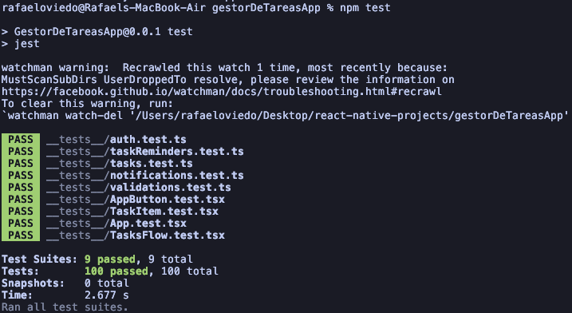

# Gestor de Tareas

## ¿De qué va la app?

Aplicación móvil para organizar tareas personales. Permite registrarse, iniciar sesión, crear tareas, marcarlas como completadas o pendientes y eliminarlas. Cada usuario tiene su propia lista, guardada en el dispositivo. La sesión se mantiene al cerrar y volver a abrir la app, hasta pulsar **Cerrar sesión**.

Las tareas pueden incluir recordatorios mediante notificaciones locales a los 10 segundos, 30 segundos, 1 minuto o 5 minutos. La app funciona sin backend ni conexión a internet.

Desde **Ver detalle** se consultan los datos de cada tarea y se administran los permisos del dispositivo.

También se puede tomar una foto o elegirla desde la galería para adjuntarla a una tarea. Se muestra en la lista y en el detalle, se conserva al reiniciar la app y se puede reemplazar o quitar.

Cada tarea puede guardar su ubicación actual, con coordenadas, precisión estimada y fecha de captura. Se puede actualizar o quitar desde el detalle.

También permite elegir un contacto de la agenda como persona relacionada con la tarea. Guarda su nombre y, si están disponibles, su primer teléfono y correo; se puede cambiar o quitar desde el detalle.

Desde el detalle también se puede crear un evento en el calendario del dispositivo, eligiendo fecha, hora y duración, y eliminarlo con confirmación. El vínculo y las fechas se verifican al abrir el detalle o volver desde Calendario: si el evento ya no está disponible, se quita de la tarea. Completar o eliminar la tarea conserva el evento; para borrarlo, usar **Eliminar evento del calendario** antes de eliminar la tarea.

## Stack

- React Native CLI 0.87.1 y React 19.2.3, sin Expo.
- TypeScript.
- React Navigation con Native Stack para la navegación.
- Zustand para el estado global de tareas, con acciones de carga, creación, actualización y eliminación.
- AsyncStorage para guardar usuarios y tareas.
- Notifee para las notificaciones locales en iOS y Android.
- React Native Permissions para gestionar permisos de cámara, galería, ubicación, contactos y calendario.
- React Native Image Picker para cámara y galería, y React Native File Access para conservar las fotos en el almacenamiento privado de la app.
- React Native Community Geolocation para obtener la ubicación actual del dispositivo.
- React Native Contacts para seleccionar contactos de la agenda.
- Módulo nativo de calendario con EventKit (iOS) y Calendar Provider (Android), conectado a React Native mediante TurboModules. React Native Community DateTimePicker para elegir fecha y hora.
- Jest y React Native Testing Library para los tests.

## Uso de IA y metodología de trabajo — Parcial 2

Para ampliar la aplicación del Parcial 1 se utilizó **Codex con el modelo Astra** como asistente de desarrollo. Se contó con su ayuda para analizar los requerimientos, elaborar el plan, implementar código, crear y ejecutar tests, documentar el proyecto y corregir problemas detectados durante las pruebas de la app.

Se trabajó con un enfoque de **SDD (Spec Driven Development, o desarrollo guiado por especificaciones)**: se tomaron los requerimientos del documento de la consigna del parcial como especificación de lo que debía cumplir la aplicación. A partir de ellos se definió un plan por etapas con ayuda de Codex y se revisó antes de comenzar la implementación. Como punto de partida, se compartió la consigna en la conversación con Codex.

Se mantuvo **React Native CLI, sin Expo**, una decisión acordada previamente con el profesor. Con ayuda de Codex se implementaron las funcionalidades solicitadas con alternativas compatibles con ese entorno y, para calendario, con un módulo nativo propio.

### Plan de implementación

La implementación se organizó en los siguientes siete pasos:

1. **Estado global con Zustand:** migrar la gestión de tareas a un store con acciones para cargar, agregar, actualizar y eliminar, conservando la persistencia en AsyncStorage.
2. **Permisos y detalle de tarea:** incorporar la pantalla de detalle y la gestión de permisos para cámara, galería, ubicación, contactos y calendario, contemplando rechazos y mensajes al usuario.
3. **Cámara y galería:** permitir tomar o seleccionar una foto, asociarla a una tarea, conservarla en el dispositivo y mostrarla en la lista y el detalle.
4. **Ubicación:** obtener la posición actual, asociarla a la tarea y mostrar sus coordenadas, precisión y fecha de captura.
5. **Contactos:** seleccionar una persona de la agenda, guardar sus datos asociados a la tarea y permitir cambiarla o quitarla.
6. **Calendario:** crear un evento vinculado a la tarea, con fecha, hora y duración, y guardar su vínculo.
7. **Testing y documentación:** revisar el cumplimiento de los requerimientos, completar las pruebas automatizadas y documentar la instalación, ejecución y verificación manual.

Con ayuda de Codex se incorporaron los tests y la documentación durante cada etapa, y se dedicó el último paso a consolidar esa revisión. Después se solicitaron ajustes a partir de las pruebas y los problemas observados, como mejorar el selector de fecha y hora e incorporar la eliminación y verificación de eventos del calendario.

La definición del alcance, la revisión del plan y la decisión de avanzar entre etapas quedaron a cargo del alumno, al igual que la compilación y las comprobaciones visuales y nativas de la app. Estas comprobaciones se complementaron con los tests automatizados ejecutados con ayuda de Codex: utilizan mocks para las APIs del dispositivo y no reemplazan las pruebas en simulador o teléfono.

## Instalación y ejecución

### Requisitos

- Node.js 22.11.0 o superior y npm.
- **iOS:** macOS, Xcode con un simulador instalado, Ruby y Bundler. El proyecto usa Ruby 3.1.4 y Bundler 2.3.26 en `Gemfile.lock`.
- **Android:** Android Studio, Android SDK y JDK configurados, con un emulador o dispositivo conectado.

### Instalar dependencias

Desde la carpeta del proyecto:

```sh
npm ci
```

Para iOS, instalar también las dependencias nativas:

```sh
bundle install
cd ios
bundle exec pod install
cd ..
```

### Ejecutar la app

Iniciar Metro desde la raíz del proyecto:

```sh
npm start
```

Con Metro abierto, ejecutar en otra terminal desde la misma carpeta:

**iOS**, con el simulador de iPhone abierto:

```sh
npm run ios
```

**Android**, con el emulador abierto o un dispositivo conectado con depuración USB:

```sh
npm run android
```

Ejecutar los comandos sin `sudo`. Al abrir la app, registrar una cuenta e iniciar sesión. Para probar los recordatorios, crear una tarea con la opción **10 segundos** y aceptar el permiso de notificaciones; en Android, habilitar también Alarmas y recordatorios si la app lo solicita.

Para adjuntar una foto, abrir **Ver detalle** en una tarea y pulsar **Tomar foto** o **Elegir de galería**. Para probar la cámara, usar un dispositivo físico; en el simulador de iPhone se puede probar la galería arrastrando una imagen al simulador.

Para guardar un lugar, pulsar **Usar ubicación actual** desde el detalle y aceptar el permiso. En el simulador de iPhone, seleccionar una ubicación simulada desde **Features → Location**; en un dispositivo físico, activar los servicios de ubicación.

Para asociar una persona, pulsar **Elegir contacto** desde el detalle, autorizar el acceso y seleccionar un contacto. En el simulador de iPhone se pueden crear contactos desde la app **Contactos**. Si se autorizó el acceso solo a algunos contactos, se puede cambiar esa selección desde Ajustes.

Para agendar una tarea, pulsar **Agregar al calendario**, autorizar el permiso, elegir fecha, hora y duración y pulsar **Crear evento**. Luego verificarlo en la app Calendario. En iOS se usa el calendario predeterminado y se necesita acceso completo para consultar y eliminar eventos; en Android se puede elegir un calendario disponible. El dispositivo o simulador debe tener un calendario configurado que permita agregar eventos.

Si antes se autorizó solo agregar eventos en iOS, pulsar **Actualizar evento** en el detalle para solicitar acceso completo. Las verificaciones automáticas no muestran diálogos de permisos. Si el acceso se rechaza o la consulta falla, se conservan los datos guardados y se informa el error. **Eliminar evento del calendario** elimina el evento y su vínculo, conservando la tarea y su recordatorio.

Los botones de ajustes abren la configuración de la app. Si iOS no muestra opciones, buscar **Ajustes → Apps → Gestor de Tareas** o el recurso en **Privacidad y seguridad** después de haber solicitado el permiso. La cámara del simulador no sustituye una prueba en iPhone físico; usar la galería para la demostración en simulador.

### Verificación manual para la entrega

Después de compilar, realizar este recorrido en iOS y Android:

1. Registrar una cuenta, iniciar sesión y crear una tarea con recordatorio de **10 segundos**. Verificar que llegue la notificación.
2. Adjuntar una foto, guardar la ubicación, elegir un contacto y crear un evento. Comprobar la imagen en la lista y el detalle, las coordenadas y el contacto en el detalle, y el evento en la app Calendario.
3. Completar y volver a poner pendiente la tarea. Cerrar la app desde el selector de aplicaciones y abrirla: deben conservarse la sesión, la tarea y sus datos asociados.
4. Cerrar sesión e ingresar con otra cuenta: la tarea anterior no debe aparecer. Volver a la primera cuenta y verificar que sigue guardada.
5. Cuando el sistema solicite permiso para un recurso, rechazarlo, habilitarlo desde Ajustes y reintentar. Verificar los mensajes y que se pueda seguir usando la app. En Android, la galería usa el selector del sistema sin acceso amplio a las fotos; cancelar ese selector o la selección de contacto tampoco debe modificar la tarea.
6. Cambiar la fecha del evento desde Calendario y volver al detalle: debe actualizarse. Borrarlo desde Calendario y volver: debe desaparecer el vínculo, conservando la tarea. Crear otro evento y probar **Eliminar evento del calendario**, primero cancelando y luego confirmando.
7. Quitar o reemplazar los datos adjuntos y eliminar la tarea. Si todavía tenía un evento, este se conserva en Calendario y se puede borrar allí.

Para repetir un diálogo de permiso, restablecer el permiso del recurso desde el sistema según el dispositivo. La cámara requiere un dispositivo físico; la ubicación, los contactos y el calendario necesitan los datos de prueba indicados arriba.

## Ejecutar los tests

Con las dependencias instaladas (`npm ci`), ejecutar desde la raíz del proyecto:

```sh
npm test
```

Los tests usan Jest y React Native Testing Library. No requieren iniciar Metro, abrir un emulador ni compilar la app.

Para generar el informe de cobertura:

```sh
npm run test:coverage
```

El resumen aparece en la terminal y el informe navegable se guarda en `coverage/index.html`. La carpeta `coverage/` no se sube a Git. Se mide el código TypeScript/JavaScript de la app, excluyendo declaraciones de tipos y estilos.

Los tests cubren componentes reutilizables, navegación y formularios, autenticación, acciones de Zustand, persistencia, recordatorios, permisos y recursos del dispositivo. También verifican errores de almacenamiento, aislamiento entre usuarios y una tarea que combina foto, ubicación, contacto y evento.

Las APIs nativas usan mocks en Jest: estos tests verifican el comportamiento de la app, pero la cámara real, la recepción de notificaciones y la creación de eventos en el calendario deben comprobarse con el recorrido manual anterior.

Revisión del 07/11/2026: **239 tests aprobados en 22 suites**, con **93,14 % de cobertura de líneas**. Esta revisión no incluye compilación ni ejecución nativa en simuladores o dispositivos.

Para revisar el código con ESLint:

```sh
npm run lint
```

Si Watchman falla en el entorno local, se puede ejecutar `npm test -- --runInBand --watchman=false` o `npm run test:coverage -- --watchman=false`.

La siguiente captura corresponde al Parcial 1; el total actual se obtiene al ejecutar los tests:


